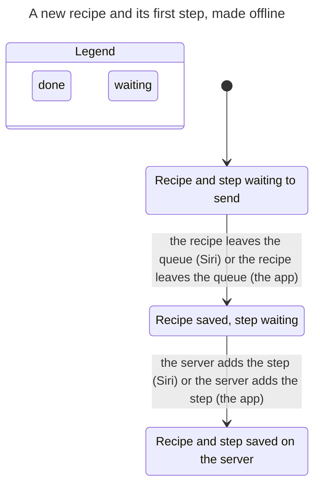

# Sync drain model

A [`/statechart`](https://github.com/cursor/plugins/tree/main/pstack/skills/statechart) model (TLA+, checked by TLC) of `NativeSyncEngine.bootstrapAndDrain` following one story: offline, you create a recipe and add a step to it, so the step points at the recipe's temporary id until the server names the real one. `Drains` is the set of sync passes on the one shared store: the app's, and the one a Siri or Shortcuts intent starts.

| Rule | In your words |
|---|---|
| `NeverSentWithTemporaryId` | A step on a new recipe is never refused just because it went out with the temporary id. |
| `QueuedStepPointsAtRealRecipe` | Once the recipe is created, a queued step for it points at the real recipe. |
| `AtRestStepPointsAtRealRecipe` | The same, checked only while no sync runs. |
| `StepAddedOnce` | The step is added on the server once. |

- `OneDrain.cfg`: the app's sync alone. Every rule holds.
- `TwoDrains.cfg`: the app and Siri, taking turns (`NativeSyncDrainTurns`). Every rule holds.
- `TwoDrainsBefore.cfg`: the app and Siri at once, as before the turns. The first three rules break; `NativeSyncDrainTurnsTests` is that path as a test.

Run it with pstack's script (it installs TLC through mise, or takes `TLA2TOOLS` and `JAVA`):

```sh
statechart NewRecipeDrain.tla --config TwoDrains.cfg --view view.mjs --out /tmp/sync-drain
```

With the app and Siri taking turns:


